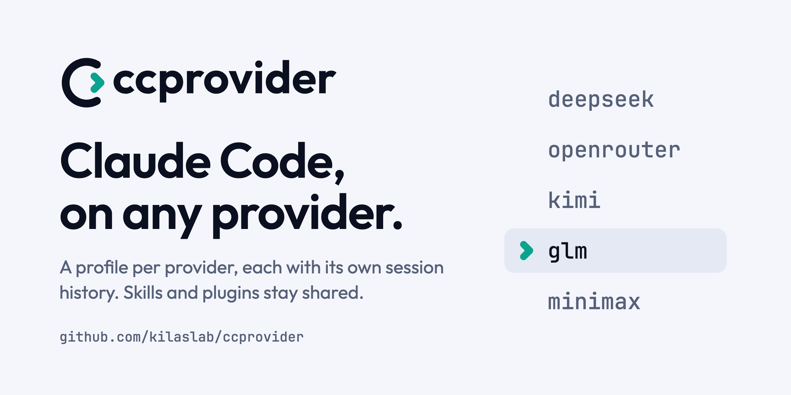
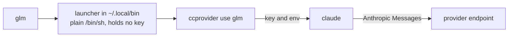

<p align="center">
  <picture>
    <source media="(prefers-color-scheme: dark)" srcset="assets/banner/banner-dark.png">
    <source media="(prefers-color-scheme: light)" srcset="assets/banner/banner-light.png">
    
  </picture>
</p>

<p align="center">
  <a href="https://github.com/kilaslab/ccprovider/actions/workflows/ci.yml"></a>
  <a href="https://github.com/kilaslab/ccprovider/releases"></a>
  <a href="LICENSE"></a>
  
  
</p>

<p align="center">
  <a href="#install">Install</a> ·
  <a href="#quick-start">Quick start</a> ·
  <a href="#how-it-works">How it works</a> ·
  <a href="#commands">Commands</a> ·
  <a href="#providers">Providers</a> ·
  <a href="#guides">Guides</a> ·
  <a href="#faq">FAQ</a> ·
  <a href="#for-ai-agents-and-scripts">For AI agents</a>
</p>

**ccprovider** runs Claude Code against DeepSeek, OpenRouter, Kimi, GLM, MiniMax, or any other
Anthropic-compatible endpoint. Each provider is a named profile with its own session history,
and every profile shares the skills and plugins you already have. Each profile is also a
command: `glm`, `deepseek`, whatever you named it.

```bash
git clone https://github.com/kilaslab/ccprovider && cd ccprovider
npm install && npm link     # builds it, and puts `ccprovider` on your PATH
                            # (or, from the registry: `npm install -g @kilaslab/ccprovider`)

ccprovider add              # pick a provider, paste a key
deepseek                    # launches claude, pointed at DeepSeek
```

There is no proxy and no request translation. `ccprovider` sets environment variables and
`exec`s the real `claude` binary, so nothing sits in the request path.

## Highlights

- **One profile per provider.** Session history, `projects/` and cost tracking stay per
  profile. Skills, plugins, rules, `CLAUDE.md` and `settings.json` are symlinked from
  `~/.claude`, so you install a skill once and every profile sees it.
- **Every profile is a command.** `glm --resume` and `deepseek -p "summarise this repo"`
  pass everything after the name straight to `claude`.
- **Model tiers mapped properly.** Opus, Sonnet, Haiku and the subagent slot all point at
  models your provider serves, and the model's real context window is declared.
- **`doctor` tests the whole path.** A real one-token request through every alias slot,
  plus the setup around it.
- **Keys stay out of files.** macOS Keychain, libsecret on Linux, or an encrypted file.
  Never `providers.json`, a launcher or an MCP config.
- **A second Claude login.** A Claude subscription profile keeps a work and a personal
  account signed in side by side.
- **Agents and MCP tools per profile.** Subagents from an open-source collection, and Z.ai's
  four MCP servers on GLM.
- **Scriptable.** `ccprovider env` prints a profile's variables as shell exports, a Docker
  `--env-file`, or JSON for the Agent SDK.
- **Token usage per model.** `ccprovider usage` reads the transcripts Claude Code already
  keeps, so nothing runs in the request path.

## Install

Needs **Node 20.11 or newer** on macOS or Linux (WSL works), and Claude Code on your
`PATH`. Bun is only for developing ccprovider; you don't need it to use it.

**From npm.** The command is still `ccprovider`; the package lives under the `@kilaslab`
scope, with a build-provenance statement you can see on its npm page:

```bash
npm install -g @kilaslab/ccprovider
```

The other two routes never touch the registry for ccprovider itself.

**Clone it and use it.** The whole thing, no global install required:

```bash
git clone https://github.com/kilaslab/ccprovider && cd ccprovider
npm install              # fetches the one dependency and builds dist/  (bun install works too)
node dist/cli.js add     # run it right there
```

To have the `ccprovider` command available everywhere, run `npm link` (or `bun link`) in
the clone once. Updating is `git pull && npm install`. If you'd rather skip the build while
you change something, `bun run src/cli.ts add` runs the TypeScript as it is.

**A release tarball.** From 0.1.1 on, each [GitHub release](https://github.com/kilaslab/ccprovider/releases)
carries the packed package, already built, with a build-provenance attestation you can check:

```bash
npm install -g https://github.com/kilaslab/ccprovider/releases/download/vX.Y.Z/kilaslab-ccprovider-X.Y.Z.tgz
gh attestation verify kilaslab-ccprovider-X.Y.Z.tgz --repo kilaslab/ccprovider     # after downloading it
```

Up to 0.2.0 the file is called `ccprovider-X.Y.Z.tgz`; from 0.2.1 it is `kilaslab-ccprovider-X.Y.Z.tgz`.

After updating any of these, run `ccprovider install` to refresh launcher commands that
point at the old copy (see [Profiles as commands](#profiles-as-commands)).

Native Windows isn't supported: the profile directories and commands rely on POSIX symlinks
and `/bin/sh`.

## Quick start

```bash
ccprovider add        # wizard: pick a provider, paste a key, choose models and agents
deepseek              # launch Claude Code on DeepSeek; the command is named after the profile
ccprovider doctor     # check the profile end to end
ccprovider ls         # list profiles and their state
```

Everything after the profile name goes to `claude`:

```bash
deepseek --resume
deepseek -p "summarise this repo"
ccprovider use deepseek -m haiku -- --resume     # the long form, with a model tier
```

## How it works



The launcher is the only thing you type. `ccprovider use` is the one place that reads your
key and builds the environment, and `claude` then talks to the provider directly. Nothing
sits between them.

## Why not just export the variables yourself

You can. The reason this exists is that the hand-rolled version is wrong in ways that
don't announce themselves.

**Claude Code resolves models by tier, not by ID.** `/model` offers Opus/Sonnet/Haiku.
Subagents request a tier by name. Background summarisation asks for haiku. If you set
only `ANTHROPIC_MODEL`, every one of those still asks for a *Claude* model ID that your
provider has never heard of. The session appears to work, then Task spawns fail and
background requests 404 silently.

A correct setup maps every slot:

```bash
ANTHROPIC_MODEL=deepseek-v4-pro[1m]
ANTHROPIC_DEFAULT_OPUS_MODEL=deepseek-v4-pro[1m]
ANTHROPIC_DEFAULT_SONNET_MODEL=deepseek-v4-pro[1m]
ANTHROPIC_DEFAULT_HAIKU_MODEL=deepseek-v4-flash
CLAUDE_CODE_SUBAGENT_MODEL=deepseek-v4-flash    # ← the one everyone forgets
```

**Claude Code assumes 200k for any model it doesn't recognise**, which is every
third-party model ID. It says so out loud if you look: `[claude-code:unrecognized_model]`.
Set only `CLAUDE_CODE_AUTO_COMPACT_WINDOW` and a 262k model still gets truncated to 200k.
The real window has to be declared:

```bash
CLAUDE_CODE_MAX_CONTEXT_TOKENS=1048576      # the model's true window
CLAUDE_CODE_AUTO_COMPACT_WINDOW=786432      # compact below it, for headroom
```

The `[1m]` suffix covers the 1M case; this covers every other size.

**A third-party model may report that it has no Bash.** Claude Code sends most tools as
names to be loaded through a `ToolSearch` tool, and a model that does not use it sees
`ToolSearch` as its only tool (glm-5.3-flash said it had no shell, with `Bash` in the
session's tool list). `ccprovider` sets `ENABLE_TOOL_SEARCH=false` so every tool arrives
whole; a subscription profile keeps Claude Code's own default.

**Not every model can drive an agent.** Of OpenRouter's 400+ models, roughly 70 can't
tool-call at all. Pick one and Claude Code looks broken rather than telling you why.
`ccprovider add` hides them.

**Launching from inside a Claude Code session leaks the parent's identity.** An existing
session exports `CLAUDE_CODE_SESSION_ID` and a messaging socket to its children; inherit
those and the new instance attaches to the wrong session. `ccprovider` strips them.

## Profiles are isolated but not duplicated

Each profile gets its own config directory. Your skills, plugins, rules, `CLAUDE.md` and
`settings.json` are **symlinked** from `~/.claude`, so they're shared and stay in sync:
install a skill once and every profile sees it. Session history, `projects/`, and cost
tracking are per-profile and never mix.

```
~/.local/share/ccprovider/dirs/deepseek/
├── skills        -> ~/.claude/skills
├── plugins       -> ~/.claude/plugins
├── rules         -> ~/.claude/rules
├── CLAUDE.md     -> ~/.claude/CLAUDE.md
├── settings.json -> ~/.claude/settings.json
├── history.jsonl     (this profile only)
└── sessions/         (this profile only)
```

Links are reconciled before every launch, so anything you add to `~/.claude` later shows
up without re-running setup. `ccprovider rm` unlinks rather than follows, so your real
config is never touched.

If you would rather one provider's sessions be the same sessions `claude --resume` sees,
turn on sharing. `ccprovider add` and `ccprovider edit` ask ("Share chat sessions with the
plain claude?", **No** unless you changed the default). An answer that only repeats the
default is not stored, so the profile keeps following it. To change it later, or to change
the default for every profile, run `ccprovider settings` — a menu that lists the default and
each profile with what it resolves to:

```bash
ccprovider settings                                 # the menu
ccprovider settings set shareSessions true          # every profile that has no override (scripts)
ccprovider settings set shareSessions true glm      # just glm
ccprovider settings unset shareSessions glm         # glm follows the default again
```

A sharing profile runs in `~/.claude` itself, so its new sessions, `--resume` history and
todos are the plain `claude`'s. A Claude subscription profile signed in with `/login` never
shares: its login lives in its own directory, and sharing would put it next to everyone else's
sessions. One signed in with a setup-token can, since its credential is not in a directory.
While a profile shares it has no agents or MCP servers of its own to install. Sessions it
had before stay in its own directory; `ccprovider usage glm` still reports them.

## Commands

| Command | What it does |
|---|---|
| `ccprovider add` | set up a profile (and install it as a command). `--default` writes the one profile behind the plain `claude`; `--provider <id> --key-stdin …` skips the wizard |
| `ccprovider ls` | list profiles and their state |
| `ccprovider use <name> [-m tier]` | launch Claude Code |
| `ccprovider edit <name>` | change models, key, endpoint, or MCP servers |
| `ccprovider rename <old> <new>` | rename a profile, its key, its history, and its command |
| `ccprovider rm <name>` | delete a profile, its key, its history, and its command (also `delete`) |
| `ccprovider install [name]` | make a profile a command (all profiles if no name) |
| `ccprovider uninstall [name]` | remove a command (the profile stays) |
| `ccprovider default [<name>\|--off\|--use <provider>\|--forget <provider>]` | make a profile the plain `claude` command, put the real one back, or swap the default to a provider it kept |
| `ccprovider doctor [name]` | check everything, end to end |
| `ccprovider statusline [add\|rm]` | show context use in Claude Code's footer; one install covers every profile |
| `ccprovider usage [name]` | tokens used per model: input, output and cache (`--since`, `--by day`, `--json`) |
| `ccprovider env <name> [--format sh\|dotenv\|json]` | print the variables it would set |
| `ccprovider agents <name>` | list a profile's agents and its Explore model |
| `ccprovider agents add\|rm <name> <id…>` | install or remove agents |
| `ccprovider agents explore <name> <model>` | run Explore on `haiku`, `sonnet`, `opus`, a model ID, or `default` |
| `ccprovider settings [set shareSessions true\|false [name]]` | a menu to share sessions with the plain `claude`, for every profile or one; `set` does the same for scripts |
| `ccprovider init` | add ccprovider's `PATH` entries to your zsh or bash startup file |

`add` and `edit` take `--refresh` to bypass the 24-hour model-list cache. `add` takes
`--no-install` to skip installing the command. `-y` skips confirmation prompts.

`add --provider <id>` runs without the wizard, for scripts: the key is read from standard input
(`--key-stdin`, never an argument) and the other flags answer its questions (`--name`,
`--base-url`, `--opus --sonnet --haiku --subagent`, `--start`, `--context`, `--compact`,
`--share-sessions`, `--agents`, `--explore`, `--mcp`; `ccprovider --help` lists them). A preset
fills in what you leave out. The endpoint and every model are checked first, and a failure
exits non-zero (`--no-probe` skips that). Nothing is asked: replacing the default needs `-y`.

`-m` takes a tier (`opus`, `sonnet`, `haiku`), `opusplan`, or a raw provider model ID.
Anything after `--` goes straight to `claude`:

```bash
ccprovider use deepseek -m haiku -- --resume
```

### Opus, Sonnet and opusplan

`add` and `edit` ask for the Opus and Sonnet models separately, so a provider with a heavy
and a light flagship can have both. When they differ, you also pick what sessions start
on: either one, or **`opusplan`**, Claude Code's mode that plans on the opus model and
switches to the sonnet model to carry out the plan:

```
◇ Opus model    glm-5.3
◇ Sonnet model  glm-5.3-flash
◇ Start sessions on
│ ● opusplan  plan on glm-5.3, execute on glm-5.3-flash
```

The choice is the profile's default, so plain `glm` launches into it; `/model` switches
for the session. Context window and output cap are set once for both models, so `add`
suggests the smaller of the two.

### doctor

`doctor` sends a real one-token request through **every** alias slot, which is the fastest
way to find an unmapped tier. It also checks the parts around the request:

```
glm  https://api.z.ai/api/anthropic
  ✓ claude on PATH
  ✓ shared config links      5/7 linked to ~/.claude
  ✓ model tier mapping       opus, sonnet, haiku and subagent all mapped
  ✓ API key (macOS Keychain) present
  ✓ command `glm`            ~/.local/bin/glm
  ✓ settings.json overrides  sets none of the variables ccprovider manages
  ✓ MCP web-search-prime     Web search
  ✓ MCP zread                Zread
  ✓ endpoint format          speaks Anthropic Messages
  ✓   opus -> glm-5.3        resolves
  ✓   haiku -> glm-5.2       resolves
```

## Providers

Built-in presets: **DeepSeek**, **OpenRouter**, **Kimi/Moonshot**, **GLM/Z.ai**,
**MiniMax**, and **Custom** for LiteLLM, llama.cpp, or a self-hosted gateway. Every base URL
was verified against the live API, and the wizard fetches the provider's current model
list with your key, so a preset that goes stale corrects itself at setup time.

- **OpenRouter** gets the richest treatment. Its catalog is public and carries per-model
  context length, output caps, tool support, vision support, and pricing, all shown in a
  searchable picker.
- **GLM/Z.ai** gets Z.ai's four MCP servers on top; see [GLM MCP tools](#glm-mcp-tools).
- **Claude subscription** is not a provider but a second login; see below.

### Claude subscription

Pick it in `ccprovider add` to get a profile with its own Claude account, for example a
work subscription next to your personal one. It sets only `CLAUDE_CONFIG_DIR`, so Claude
Code keeps that profile's login (`.credentials.json`, or a Keychain entry keyed to the
directory on macOS) apart from `~/.claude` and every other profile. Run the profile, type
`/login` once, and both accounts stay signed in side by side. It stores no API key and has
no endpoint or model mapping; `ccprovider doctor` skips those checks for it.

#### Claude subscription (setup-token)

The other Claude option signs in with a long-lived token instead of `/login`. Run
`claude setup-token` once, pick **Claude subscription (setup-token)** in `ccprovider add`, and
paste the token. It is kept in your Keychain (or the other secret store `doctor` names) like an
API key and handed to Claude Code as `CLAUDE_CODE_OAUTH_TOKEN`; it goes to Anthropic and nowhere
else, and a provider profile still strips any such token from its environment.

Because the credential is in the environment and not in a config directory, this kind **can
share chat sessions** with the plain `claude` (`add` and `edit` ask; `ccprovider settings` flips
it later). A `/login` profile cannot: its login lives in its own directory.

### One default, replaced in place

```bash
ccprovider add --default     # pick any provider; it is written as the profile "default"
ccprovider default --use claude-token   # later: swap to one it kept, no wizard
```

`add --default` skips the name question and writes a single profile called `default`, then makes
the plain `claude` run it. Run it again with another provider and the profile is overwritten
rather than a new one added, and its session history is kept. What it replaced is **kept too**:
its profile and key, filed under their provider, so `ccprovider default --use <provider>` brings
them back with nothing typed. That is what you want when a Claude subscription runs out mid-work:
`ccprovider default --use deepseek`, then `claude --continue`. The name `default` is reserved for
this profile. Details and the limits: [docs/default-command.md](docs/default-command.md#one-profile-called-default-replaced-in-place).

### OpenAI-compatible endpoints

Not supported directly, by design. Claude Code needs the Anthropic Messages format;
translating between the two means owning streaming reassembly, tool-call mapping and
thinking-block conversion forever. If you have an OpenAI-only endpoint, front it with
LiteLLM and point `ccprovider` at that:

```bash
litellm --model openai/YOUR_MODEL --api_base https://your-endpoint/v1
ccprovider add   # base URL: http://localhost:4000
```

`ccprovider add` detects OpenAI-format URLs and prints this rather than saving something
that can't work.

## Guides

### Profiles as commands

`ccprovider add` installs the profile as a command of the same name, so `glm` starts
Claude Code against GLM from any shell, and everything you type after it goes to `claude`:

```bash
glm
glm --resume
glm -p "summarise this repo"
```

The command is a short `/bin/sh` script in `~/.local/bin`. It holds no key and no
configuration: it runs `ccprovider use glm -- "$@"`, and that is the one place that
reads your key and builds the environment. Because it is plain `sh`, it works the same
from bash, zsh and fish.

`~/.local/bin` has to be on your `PATH` (Claude Code installs itself there too, so it
usually is). If it isn't, `add` and `doctor` say so and print the line to add;
`ccprovider init` adds it for you (zsh and bash), between marker lines you can delete.

`-m` isn't available through the command (the command owns your arguments). For a
one-off tier, use `ccprovider use glm -m haiku`, or claude's own flag through the
command: `glm --model opusplan`.

The commands are careful about what they touch:

- **They never overwrite a file they didn't write.** If `~/.local/bin/kimi` is a real
  program, a profile named `kimi` is still fine. It just isn't installed as a command,
  and `ccprovider install kimi` tells you why. Only files carrying ccprovider's marker
  are ever replaced or deleted, and a symlink is never treated as one of them.
- **`add` steps aside for a real program.** If a profile is called `gemini` and a real
  `gemini` is already on your `PATH`, a launcher would silently turn that program into
  Claude Code. So the automatic install skips it and says so; asking by name
  (`ccprovider install gemini`) is taken as intent, and it tells you what it now stands
  in front of.
- **A few names can never be commands:** `claude`, `ccprovider`, `python3`, `python`,
  `security`, `secret-tool`, `node` and `npx`, the programs ccprovider itself looks up on `PATH`. A
  launcher with one of those names would be found first and call itself forever. (For the
  plain `claude`, see [below](#make-a-profile-your-default-claude).)
- **`doctor` notices** a command whose target has moved, one that another program
  shadows earlier on `PATH`, and leftovers from a deleted profile.

<details>
<summary>How the launcher finds <code>node</code></summary>

<br>

The launcher points at the installed `dist/cli.js` and runs it with the `node` that
installed it, as long as that file still exists. Once it is gone (under nvm or fnm that
path changes with every Node version) it falls back on `dist/cli.js`'s own shebang, which
finds `node` on `PATH`. Trying the installing `node` first matters inside projects that put
their own `node` first on `PATH` (direnv's `PATH_add .bin` with a `docker compose exec app
node` wrapper, say): from there, the shebang alone would start ccprovider inside the
container. What the launcher does depend on is the package staying where it was. If you
switch Node versions (a global package lives under that version's directory) or move a
clone, `doctor` reports the launcher as stale and `ccprovider install` refreshes it.

</details>

### Renaming a profile

```bash
ccprovider rename zclaude glm
```

A profile's name is four things at once: its entry in `providers.json`, its directory
(which holds the session history), the account its key is filed under, and its command.
`rename` moves all four together. Each step can be undone, and the config write is the
commit point: if anything fails before it, the previous state is restored and nothing is
half-renamed.

Close any running sessions in the old profile first: they keep using the old directory.
Python virtualenvs some tools create inside a profile embed absolute paths and stop
working after the move; `rename` lists any it finds. They are rebuilt on demand, so
deleting them is safe.

### Make a profile your default `claude`

On a machine that only uses one provider, `claude` itself can run it:

```bash
ccprovider default glm       # `claude` now runs the glm profile
ccprovider default --off     # the real claude again
```

This writes a small script called `claude` into `~/.local/share/ccprovider/bin/`, not over
Claude Code's own `~/.local/bin/claude`, which its updater rewrites. Put that directory before
Claude Code's on your `PATH`; `default` prints the line, `ccprovider init` adds it to your
`~/.zshrc`, or bash's startup file (`~/.bashrc`; on macOS the first of `~/.bash_profile`, `~/.bash_login` and `~/.profile` that exists) (and `default` offers to, at a terminal), and `doctor` checks the
order. It never writes a provider into `~/.claude/settings.json`. Servers and mini PCs reached over SSH
need the line in a different startup file, and IDE extensions and the Agent SDK are not
reached at all: [docs/default-command.md](docs/default-command.md).

### Use it from the Agent SDK or Docker

The Claude Agent SDK starts its own Claude Code, so it never sees your `glm` command. Hand
it the profile's variables instead:

```bash
ccprovider env glm --format json      # an object for the SDK's env option
docker run --rm --env-file <(ccprovider env glm --format dotenv) my-agent-image
```

`dotenv` and `json` leave out `CLAUDE_CONFIG_DIR`, a path on this machine, and set
`ANTHROPIC_API_KEY` empty: Claude Code sends that key to the provider next to the token, so
an Anthropic key left in your shell would otherwise go with it. TypeScript, Python and
Docker examples, and what the SDK loads from `~/.claude` by default, are in
[docs/agent-sdk.md](docs/agent-sdk.md).

### Context use in the footer

`ccprovider add` offers a badge for Claude Code's footer once, defaulting to Yes
(`--no-statusline` skips it), and `ccprovider statusline [add|rm]` does it any time:

```
[ctx 21k/1M 2%]
```

It is [cc-token-statusline](https://github.com/Alfafis/cc-token-statusline) (MIT), pinned to one
commit with a hash per file and installed by its own installer, which wraps a status line you
already have. `settings.json` is shared, so one install shows it in every profile. On a provider
that is not Anthropic the default segments are right (context) or empty (plan quota), and its
optional token and cost segments are not: measured on GLM, tokens read two to three times too
high. Details, and what the providers offer for plan quota: [docs/statusline.md](docs/statusline.md).

## See what each profile spends

```bash
ccprovider usage              # every profile, model by model
ccprovider usage glm --since 7d --by day
```

```
glm
  model          calls   input  output  cache read  cache write  cache hit
  glm-5.3          115  229.7K   55.3K        4.1M            0        95%
  glm-5.3-flash    460  736.1K  119.7K       10.7M            0        94%
```

It reads the transcripts Claude Code keeps in each profile, subagents included, so nothing
runs in the request path. These are counts from this machine, not the provider's bill.
`--json` prints exact figures for scripts, and `--rebuild` forgets the ledger and reads the
transcripts again. How a call is counted, and why the totals survive Claude Code deleting
old transcripts: [docs/usage.md](docs/usage.md). The `default` profile may have been several
providers; its rows are grouped by the provider each call went to, from the time it was made.
A default that never changed provider looks like any other profile.

### Agents

`add` offers subagents from [VoltAgent/awesome-claude-code-subagents](https://github.com/VoltAgent/awesome-claude-code-subagents)
(MIT), with five ticked as a starting set:

```
◆  Agents  (from VoltAgent/awesome-claude-code-subagents, MIT · space to toggle)
│  ◼ code-reviewer        ◼ architect-reviewer    ◼ test-automator
│  ◼ debugger             ◼ security-auditor      ◻ qa-expert
│  ◻ refactoring-specialist  ◻ performance-engineer  ◻ documentation-engineer
```

They are installed into that profile only, next to anything you keep in
`~/.claude/agents`, which every profile still sees. Each file is pinned to one upstream
commit and checked against a hash before it is written, so what you get is exactly
what was reviewed. Their `model:` is a tier name, so `sonnet` on a GLM profile is a GLM
model. `edit` shows the same list with what is installed ticked; unticking removes it.
Later, `ccprovider agents add glm qa-expert` or `ccprovider agents rm glm debugger`.

**Explore's model.** Claude Code's built-in Explore subagent runs on the session model,
and `CLAUDE_CODE_SUBAGENT_MODEL` doesn't reach it. `add` and
`ccprovider agents explore glm haiku` give the profile a read-only Explore on the model
you pick; `default` hands it back to the built-in one.

ccprovider only ever touches files it wrote, marked by a comment inside the frontmatter
that never reaches the model. An agent you edit after installing it is left alone
(`rm -y` removes it anyway). In a profile with agents of its own, one you create in a
session stays in that profile; put agents meant for every profile in `~/.claude/agents`.

### GLM MCP tools

Z.ai ships four MCP servers to GLM Coding Plan subscribers. When you set up the GLM
preset, `add` offers all of them, ticked:

| server | what it does |
|---|---|
| `zai-mcp-server` | image, screenshot, diagram and video analysis (runs `npx @z_ai/mcp-server`) |
| `web-search-prime` | web search |
| `web-reader` | fetch a page as title, text, metadata and links |
| `zread` | search and read GitHub repositories |

They're registered inside the profile's own Claude config, so they exist for `glm` and
nowhere else. `ccprovider edit glm` changes the selection, and `doctor` confirms they are
registered as expected. Both the international (`api.z.ai`) and mainland
(`open.bigmodel.cn`) endpoints are supported; a custom gateway gets none, since it has no
MCP hosts of its own.

> [!NOTE]
> **Your key is not written into that config.** The obvious ways to authenticate both go
> wrong: writing `Bearer <key>` into `~/.claude.json` leaves the key in a plaintext file,
> and `Bearer ${ANTHROPIC_AUTH_TOKEN}` in a remote server's headers is read by Claude Code
> as *empty*, silently, so the server just answers 401. Instead each HTTP server uses a
> `headersHelper` that reads the token from the session environment on every connection,
> and refuses any value outside a plain token alphabet rather than splicing it into JSON.

The vision server runs code from npm with your key in its environment, so its version is
**pinned** in the preset rather than left to whatever npm serves next. It needs Node 22+
(Z.ai's requirement); `doctor` checks. The header helper accepts keys made of letters,
digits and `. _ ~ + / = -`, which covers Z.ai's; `doctor` says so if yours falls outside.

If you later point the profile at a different endpoint, `ccprovider edit` removes the
servers instead of leaving them registered: they would keep sending the profile's key to
the old host, and `doctor` reports any that remain.

> [!WARNING]
> **If you also use Z.ai's `coding-helper`:** it writes `ANTHROPIC_BASE_URL` and
> `ANTHROPIC_AUTH_TOKEN` into `~/.claude/settings.json`, which every profile links to.
> Claude Code applies a settings file's `env` **over** the environment ccprovider builds,
> so that would point every profile at Z.ai. `doctor` flags this as a failure.

## Where things live

| | |
|---|---|
| profiles | `~/.config/ccprovider/providers.json` |
| settings | `~/.config/ccprovider/settings.json` |
| API keys | macOS Keychain · libsecret on Linux · encrypted file as fallback |
| profile dirs | `~/.local/share/ccprovider/dirs/<name>/` |
| commands | `~/.local/bin/<name>` (override with `CCPROVIDER_BIN_DIR`) |
| default `claude` | `~/.local/share/ccprovider/bin/claude` (override with `CCPROVIDER_DEFAULT_BIN_DIR`) |
| usage ledgers | `~/.local/share/ccprovider/usage/<name>.json` |
| MCP servers | inside each profile dir, in its own `.claude.json` |
| model cache | `~/.cache/ccprovider/` |

Keys are never written to `providers.json`, to a command, or to an MCP config. The
encrypted-file fallback (headless Linux with no keyring) uses AES-256-GCM with a `0600`
key file. That keeps secrets out of backups and synced dotfiles, but anything running as
your user can read it. `doctor` tells you which backend is in use.

One known limit: on macOS the Keychain entry is written by calling `security
add-generic-password`, which takes the secret as an argument, so it is visible to other
processes of your user in `ps` for the moment that call runs. That happens when a key is
stored (`add`, `edit`, `rename`), which is rare and interactive. Launching a profile reads
the key back through a pipe, not an argument.

Profile names are lowercased. macOS and Windows filesystems are case-insensitive, so
`DeepSeek` and `deepseek` would otherwise share one config directory while being two
separate entries.

## FAQ

<details>
<summary><b>Is this allowed?</b></summary>

<br>

Yes. `ANTHROPIC_BASE_URL` is a documented Claude Code feature intended for gateways, and
providers like DeepSeek and OpenRouter document Claude Code as a client of their
Anthropic-compatible endpoints. In this mode no request reaches Anthropic.

Don't do the reverse: piping Claude subscription credentials into third-party tools is
what actually violates the terms. A Claude subscription profile does not do that. A `/login` one
never reads or moves the login, it only gives Claude Code its own config directory to
sign in to. A setup-token one reads the token you pasted from the secret store and hands it
to Claude Code, which sends it to Anthropic and nowhere else. Use it with accounts that are yours to use.

</details>

<details>
<summary><b>Where is my API key stored?</b></summary>

<br>

In the macOS Keychain, or in libsecret on Linux. On a headless Linux box with no keyring it
falls back to an AES-256-GCM encrypted file. Never in `providers.json`, in a launcher
command, or in an MCP config.
`ccprovider doctor` tells you which backend a profile uses.

</details>

<details>
<summary><b>Will my history mix with plain <code>claude</code> or with other profiles?</b></summary>

<br>

Not unless you ask for it. Session history, `projects/` and cost tracking are per profile.
Only skills, plugins, rules, `CLAUDE.md` and `settings.json` are shared, through symlinks
to `~/.claude`. `ccprovider settings set shareSessions true [profile]` opts a profile into
running in `~/.claude` itself, so its sessions are the plain `claude`'s; see
[Profiles are isolated but not duplicated](#profiles-are-isolated-but-not-duplicated).

</details>

<details>
<summary><b>Can I use an endpoint that only speaks the OpenAI format?</b></summary>

<br>

Not directly. Put LiteLLM in front of it and point a Custom profile at LiteLLM. The steps
are under [OpenAI-compatible endpoints](#openai-compatible-endpoints).

</details>

<details>
<summary><b>A profile command stopped working after I switched Node versions.</b></summary>

<br>

A global package lives under the active Node version's directory, so the launcher can end
up pointing at a path that no longer exists. `ccprovider doctor` reports the launcher as
stale, and `ccprovider install` refreshes it.

</details>

<details>
<summary><b>Does it run on Windows?</b></summary>

<br>

Not natively. The profile directories and commands rely on POSIX symlinks and `/bin/sh`.
WSL works.

</details>

## For AI agents and scripts

Facts an automated reader can rely on. Each one is stated in more detail elsewhere in this
README.

| | |
|---|---|
| What it is | A Node CLI that launches Claude Code with the environment for a chosen Anthropic-compatible provider |
| Binary | `ccprovider`. Check it with `ccprovider --version` |
| Needs | Node 20.11+, macOS or Linux (WSL works), `claude` on `PATH`. Native Windows is not supported |
| Interactive commands | `add`, `edit`, and `agents add` without IDs open prompts. `-y` skips confirmation prompts. `add --provider <id> --key-stdin …` never prompts: the key is read from stdin and a failed check exits non-zero |
| The default `claude` | `add --default` writes the one profile `default`; `default --use <provider>` swaps to one it kept. `default` is a reserved profile name |
| Launch | `ccprovider use <name> [-m tier] [-- <claude args>]`, or the installed command `<name> [<claude args>]` |
| Headless run | `<name> -p "<prompt>"` passes `-p` to `claude` |
| Environment | `ccprovider env <name> --format sh\|dotenv\|json` |
| Health check | `ccprovider doctor [name]` |
| Token usage | `ccprovider usage [name] --json` |
| Profile names | Lowercased. `default` is reserved for `add --default`. `claude`, `ccprovider`, `python3`, `python`, `security`, `secret-tool`, `node` and `npx` can't be command names |
| State | See [Where things live](#where-things-live). Keys are in the OS keyring, never in config |
| Out of scope | OpenAI-format endpoints (front them with LiteLLM), request translation, proxying |

## Contributing and security

See [CONTRIBUTING.md](CONTRIBUTING.md). It also explains how to probe a provider's
endpoint before proposing a preset. Report vulnerabilities privately, as described in
[SECURITY.md](SECURITY.md), not in a public issue.

The logo and banner live in [`assets/`](assets/README.md).

## License

[MIT](LICENSE)
